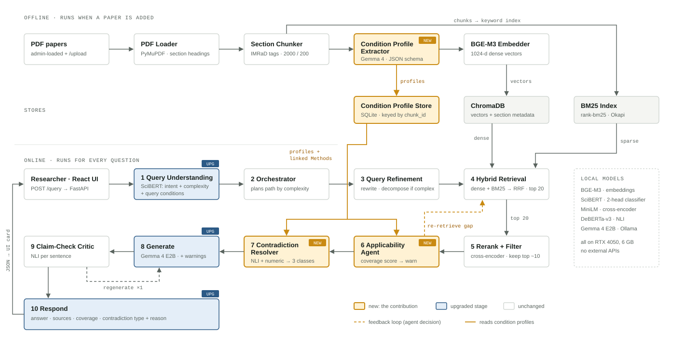

# Condition-Grounded Scientific RAG

> Ask questions about research papers and get answers that **know under which conditions a number was measured**.
> A BE major project (Dept. of Information Science and Engineering, B.M.S. College of Engineering, Bengaluru).
> Everything runs on your own machine (Ollama + Hugging Face models). No external API is part of the system.

**New here?** Read sections 1 to 4 (10 minutes). Section 5 is the one-page tour of the code. Section 6 gets the system running. The rest is reference.

## Contents

1. [The problem in one minute](#1-the-problem-in-one-minute)
2. [What this project adds](#2-what-this-project-adds)
3. [Key words explained](#3-key-words-explained)
4. [Architecture](#4-architecture) (the design diagram and stage table, the pipeline as built, offline part, online part, the two new stages, design versus build)
5. [Repository tour](#5-repository-tour)
6. [Setup and first run](#6-setup-and-first-run)
7. [Using the system](#7-using-the-system) (command line, API, web page, uploading a paper, switches)
8. [Evaluation: what was measured and how much to trust it](#8-evaluation-what-was-measured-and-how-much-to-trust-it)
9. [Known limitations](#9-known-limitations)
10. [Extending the project](#10-extending-the-project)
11. [FAQ](#11-faq)
12. [Licence and data](#12-licence-and-data)

---

## 1. The problem in one minute

A number in a research paper is only true **for the conditions it was measured in**:
the data set and its version, the model and its size, the language, the setting (zero-shot, 5-shot, fine-tuned), the split (dev or test).

An ordinary question-answering system over papers (a "RAG" system, see the glossary) ignores this. Two things go wrong:

* **It answers from evidence that does not cover the question.** Example: *"What is the accuracy of XLM-R on XNLI for Kannada?"*
  XLM-R is in the papers, XNLI is in the papers, Kannada is in the papers, but **never together** (Kannada is only evaluated on a different data set, IndicXNLI).
  A system that checks each word on its own sees "everything is there" and answers with a nearby number.
* **It cannot tell a real disagreement from a fake one.** Example: one paper says 82.3 and another says 86.9 for the same model on "SQuAD".
  They do not disagree. One used SQuAD 1.1 and the other SQuAD 2.0.

## 2. What this project adds

The system treats the conditions of every reported number as **data** and uses them in three places:

| Part | One-sentence explanation |
|---|---|
| **Condition Profile store** (built once, offline) | A table with one row for every number the papers report, plus the conditions it was measured under. |
| **Stage 6, scope check** (online) | Before answering, it checks that **one** recorded result carries **all** conditions the question names. If not, it searches once more, and otherwise it **warns and says which condition is missing** and what *is* recorded. |
| **Stage 7, conflict typing** (online) | When two papers give different numbers, it labels the pair **EXPLAINED** (a recorded condition differs), **GENUINE** (same conditions, different numbers) or **NOT COMPARABLE** (not the same quantity, or a stored record does not fit its table cell). |

Real output of the running system (shortened):

```
Q: What is the accuracy of XLM-R on the XNLI data set for the Kannada language?
Stage 6: coverage 67 % (searched again). OK data set = XNLI; MISS language = Kannada; OK model = XLM-R.
Warning: No source reports language = Kannada together with model = XLM-R, data set = XNLI.
         For model = XLM-R, data set = XNLI, the sources record: English, French, Spanish, German, Greek, Bulgarian, ...

Q: What F1 does BERT-large reach on SQuAD v1.1?
Stage 7: EXPLAINED (91.8 vs 81.8 F1): data set version (1.1 vs 2.0).
         EXPLAINED (91.8 vs 80.4 F1): model size (large vs base).
```

The rest of the pipeline is a normal RAG chain. The contribution is the layer that knows about conditions.

## 3. Key words explained

| Word | Meaning |
|---|---|
| **RAG** (retrieval-augmented generation) | Find passages in documents first, then let a language model write the answer from those passages. |
| **LLM** | Large language model (here Gemma 4, run locally through Ollama). |
| **Chunk** | A piece of a paper (about 2,000 characters, or one whole table). The unit that is searched. |
| **Embedding / vector** | A list of numbers that stands for the meaning of a text. Similar texts have similar vectors. Used for "dense" search. |
| **BM25** | Classic keyword search. Together with dense search it is called *hybrid retrieval*. |
| **RRF** | Reciprocal rank fusion: a simple way to merge the rankings of two searches. |
| **Reranker / cross-encoder** | A model that reads the question and a passage together and scores how well they match. |
| **NLI** | Natural language inference: a model that says whether one sentence supports or contradicts another. |
| **Condition profile** | One stored record for one reported number: model, size, data set, version, metric, value, language, setting, split, task and the quoted evidence. |
| **Retrieval card** | A short summary of what a chunk's profiles record. It is searched together with the chunk. |
| **Repair overlay** | A second table that holds corrections to profiles. The original rows are never rewritten, so every change can be counted and undone. |
| **Scope warning** | The message "no source reports these conditions together". It is a statement about the stored index, not about the literature. |
| **Joint coverage** | The rule that one recorded result must carry all named conditions together. |
| **Ablation switch** | A flag in `config.toml` that turns one part off, so its effect can be measured. |
| **Ollama** | The program that runs local LLMs and serves them on `localhost:11434`. |

## 4. Architecture

The architecture has an **offline** part (run once per paper) and an **online** part (run for every question). This section shows it twice: **4.1 is the design** (architecture v2: its diagram and its stage table), **4.2 is the same pipeline as it is built today**. 4.3 to 4.7 go through the built system step by step, and 4.8 lists where the build differs from the design.

### 4.1 The design (architecture v2)



*The design as drawn in September 2026. Amber = new (the contribution), blue = upgraded stage, white = unchanged, dashed = a feedback loop (an agent decides). The model names and the hardware in the picture are the design's own; the built system differs in places (see 4.8).*

Condition profiles are extracted once, when a paper is added. At question time, stages 6 and 7 read them after reranking has cut the candidates to about 10, which keeps pairwise NLI to about 45 pairs. The two dashed loops are the points where an agent decides to act: stage 6 searches again for a missing condition, and stage 9 regenerates an unsupported sentence once.

| | Component | What it does | Runs on | Role | Status |
|---|---|---|---|---|---|
| A | PDF Loader | Extracts text page by page and detects section headings | PyMuPDF | module | unchanged |
| B | Section Chunker | Splits text within section boundaries; tags source, page, section | LangChain splitter | module | unchanged |
| C | **Condition Profile Extractor** | Pulls a profile for each reported result from Results/Experiments chunks and links it to the Methods chunk from the same paper | Gemma 4, temperature 0 | module | **new** |
| D | Embedder | Encodes chunks as 1024-d vectors | BGE-M3 | module | unchanged |
| 1 | Query Understanding | Intent and complexity from one 2-head classifier; also extracts the conditions the question implies (language, model size, domain) | SciBERT + Gemma 4 | tool | upgraded |
| 2 | Orchestrator | Plans the path: simple questions skip refinement; complex questions are decomposed | Python | agent (planner) | unchanged |
| 3 | Query Refinement | Rewrites into technical form; decomposes multi-part questions | Gemma 4 E2B | tool | unchanged |
| 4 | Hybrid Retrieval | Dense + BM25, fused with RRF (k=60); section match gives a soft boost, not a hard filter | ChromaDB, rank-bm25 | tool | unchanged |
| 5 | Rerank + Filter | Scores question and chunk together; keeps chunks above a threshold (top ~10). Replaces the separate CRAG cosine stage | ms-marco-MiniLM | tool | merged |
| 6 | **Applicability Agent** | Checks coverage for each condition in the question; if one is missing, searches again with it added; if still missing, attaches a scope warning | Profile Store | agent (investigator) | **new** |
| 7 | **Condition-Aware Contradiction Resolver** | NLI + numeric disagreement flags candidate pairs; comparing their profiles gives genuine / explained / not comparable | DeBERTa NLI, Profile Store | agent (analyst) | **new** |
| 8 | Generate | Top 5 chunks + chat history; the prompt now carries the scope warning and the explanations for conflicts | Gemma 4 E2B, Ollama | tool | upgraded |
| 9 | Claim-Check Critic | Checks each answer sentence against its cited chunk; regenerates once if a sentence is unsupported. Replaces the RAGAS 3-retry loop at runtime | DeBERTa NLI | agent (critic) | replaced |
| 10 | Respond | The JSON adds `applicability{coverage, missing}` and `contradictions[{type, differing}]`; the UI shows a coverage bar and conflict badges | FastAPI, React | module | upgraded |

**Removed from v1, and why**

- **Tavily web fallback:** web pages have no sections or condition profiles, and it breaks the fully offline design.
- **HyDE:** a 2B model's hypothetical answers are unreliable, and searching with them adds noise and latency.
- **Semantic cache (0.92):** near-identical questions (BERT vs RoBERTa) can return a wrong cached answer.
- **Legal / Finance / Medical domains:** those documents do not follow the IMRaD section structure, and the conditions do not transfer.

**Merged or replaced**

- CRAG cosine stage + reranker become one rerank-and-threshold stage.
- The RAGAS self-check with 3 retries becomes an NLI claim check with 1 retry; RAGAS is kept for offline evaluation.
- The hard section filter becomes a soft boost, so answers that span sections are not lost.
- Two DistilBERT classifiers become one SciBERT model with two heads.
- The Groq API becomes Gemma 4 E2B on local Ollama.

### 4.2 The pipeline as built

The same pipeline as it is built today. The two new stages are marked `(NEW)`; the repair overlay, the retrieval cards and the table reader are additions to the design.

```
 OFFLINE (once per paper)                                                          scripts/ingest.py

  PDF  ->  A PDF loader  ->  B section chunker  ->  table reader  ->  C profile extractor (LLM)
                                                                             |
                                                          repair overlay (41 rules) (NEW)
                                                                             |
                    D embedder (BGE-M3)  <-  retrieval cards  <-  profile store (SQLite)
                         |                                                   |
                 Chroma + BM25 indexes                                       |
                                                                             |
 ONLINE (every question)                                          Pipeline.run(question)
                                                                             |
  question -> 1 understand -> 2 orchestrate -> 3 refine -> 4 hybrid retrieve -> 5 rerank
                                                                                  |
                                       6 SCOPE CHECK (NEW) <---- reads ----- profile store
                                                  |
                                       7 CONFLICT TYPING (NEW) <-- reads --- profile store
                                                  |
                              8 generate answer -> 9 claim critic -> 10 respond (API + web page)
```

### 4.3 Offline: from a PDF to the profile store

| Step | Name | What it does | Tool | Code |
|---|---|---|---|---|
| A | PDF loader | Reads text page by page, finds section headings, finds tables and captions. | PyMuPDF (+ layout add-on) | `src/cgrag/ingestion/pdf_loader.py` |
| B | Section chunker | Cuts the text inside section boundaries (2,000 characters, 200 overlap). Each table is kept whole as its own chunk. | LangChain splitter | `chunker.py`, `sections.py` |
| - | Table reader | Re-reads a table cell by cell and attaches each number to its row label, column header and block heading (`row label: column = value`). | plain code | `tables.py` |
| C | Condition profile extractor | Writes one profile per reported result. Code then drops profiles whose number is not in the chunk, that have no system or metric, or that are statistics. | Gemma 4 12B, JSON schema | `profile_extractor.py` |
| - | Repair overlay (NEW) | 41 named rules fix stored profiles using their own tables (a wrong measure name, an "Avg" column, a cut model name, a spelling of a benchmark ...). 39 rules are plain code. 2 rules apply decisions that the LLM took once per group of results (the data set a table was measured on when the table does not say, and the system behind a row that is labelled by a citation); each is stored with its evidence sentence and kept only when the name occurs in the paper's text. | code + stored LLM decisions | `repair.py`, `dataset_context.py`, `model_context.py` |
| - | Retrieval cards | A short summary of what each chunk records, built from its profiles. | plain code | `cards.py` |
| D | Embedder | 1,024-number vectors for chunks and cards. | BGE-M3 | `src/cgrag/models.py` |
| - | Stores | Chroma (vectors), BM25 (keywords), SQLite (profiles + the repair overlay). | | `src/cgrag/stores/` |

### 4.4 Online: what happens to a question

| Stage | Name | What it does | Model / method | Code |
|---|---|---|---|---|
| 1 | Query understanding | Intent (factual, method, result, comparison, survey) and complexity (simple, complex), plus the conditions the question names (model, data set, language, size, setting). | SciBERT classifier + LLM + a literal match against the store's vocabulary | `query_understanding.py`, `intent_classifier.py` |
| 2 | Orchestrator | Plans the path: skip refinement for a simple question, decompose a complex one. An LLM agent inside code guardrails, with a fixed-rule fallback. | Gemma 4 E2B | `orchestrator.py` |
| 3 | Refinement | Rewrites the question into technical form and splits multi-part questions. | Gemma 4 12B | `refinement.py` |
| 4 | Hybrid retrieval | Dense + BM25 search, merged by RRF (k = 60); cards are searched too; a "profile signal" adds chunks whose profiles record the named conditions together. | BGE-M3, BM25 | `retrieval.py` |
| 5 | Rerank and filter | Scores question and chunk together and keeps the best (about 10). | `bge-reranker-base` | `rerank.py` |
| **6** | **Scope check (NEW)** | See 4.5. | profile store + a small LLM agent + code guardrails | `applicability.py`, `conditions.py` |
| **7** | **Conflict typing (NEW)** | See 4.6. | NLI + numeric trigger + profile store | `contradiction.py`, `grounding.py` |
| 8 | Generate | Writes the answer from the top passages, the recorded results and the warnings of Stages 6 and 7. | Gemma 4 12B | `generate.py` |
| 9 | Claim critic | Checks every sentence of the answer against its cited source and regenerates once if one is unsupported. | DeBERTa-v3 NLI | `critic.py` |
| 10 | Respond | Returns the answer with a coverage bar, conflict badges and a step-by-step trace. | FastAPI + React | `respond.py`, `api/main.py`, `frontend/` |

`src/cgrag/pipeline/run.py` wires all ten stages into one function, `Pipeline.run(question)`, with two loops (Stage 6 back to Stage 4, Stage 9 back to Stage 8).

### 4.5 Stage 6, the scope check, in more detail

1. Look up, in the profile store, which conditions of the question are recorded among the retrieved results.
2. Let a small LLM agent judge what the profiles cannot settle. **Guardrails:** a "covered" verdict must be backed by a recorded or quoted value, and the model, data set version and model size are never decided by the LLM.
3. **Joint coverage:** when the question names a model, a data set and a language, **one** profile must record them **together** (and a named setting such as 5-shot too). Otherwise the most specific missing condition is reported.
4. If something is missing, search once more with the missing combination (the store can also pull chunks whose profile records it).
5. If it is still missing, a bigger model gives a second opinion, and then a **scope warning** names the condition and lists what is recorded for the others.

### 4.6 Stage 7, conflict typing, in more detail

1. **Trigger:** two results from different papers with the same model family, data set and metric whose values differ by more than 2 % of the larger value.
2. **Ground each profile:** read the profile's own table cell again (block heading, caption, row and column labels) to get the split (dev / test), the system kind (single / ensemble) and the size; a profile whose cell does not fit is marked NOT COMPARABLE.
3. **Compare the conditions by kind** (data set version, split, size, language, setting).
4. **Decide:** a recorded difference gives EXPLAINED and names the condition; equal recorded conditions give GENUINE; a condition recorded for only one paper counts as a probable explanation; non-matching cells give NOT COMPARABLE.

EXPLAINED means that a recorded condition differs. It does not prove that the difference accounts for the whole size of the gap.

### 4.7 Models used

| Role | Model | Where |
|---|---|---|
| Answer, Stage 1 reader, Stage 3, profile extractor | `gemma4:12b` (Ollama) | `[llm]` in `config.toml` |
| Agents of Stage 2 and Stage 6 | `gemma4:e2b` (Ollama) | `[agents]` |
| Embedder | `BAAI/bge-m3` | `[models]` |
| Reranker | `BAAI/bge-reranker-base` | `[models]` |
| NLI (Stages 7 and 9) | `MoritzLaurer/DeBERTa-v3-base-mnli-fever-anli` | `[models]` |
| Intent / complexity classifier | `allenai/scibert_scivocab_uncased`, fine-tuned here on LLM-written questions | `scripts/train_query_classifier.py` |

### 4.8 Is the architecture finished? Design versus build

**Built and integrated: yes.** All components (A to D and stages 1 to 10) exist, are tested and run in one `run(question)` path. Nothing is a stub.
**Finished as originally specified: no.** The honest list:

| Topic | Original design | As built |
|---|---|---|
| Reranker (Stage 5) | `ms-marco-MiniLM` | `bge-reranker-base` (higher hit rate on our gold pages); MiniLM stays in Stage 7's text path |
| Answer model (Stage 8) | Gemma 4 E2B | Gemma 4 12B (E2B runs the two agents) |
| Stage 2 planner | a Python agent | an LLM agent with code guardrails and a fixed-rule fallback |
| Stage 6 | per-condition coverage | adds joint coverage, a setting rule, escalation to a bigger model, profile-guided re-search |
| Stage 7 | NLI + profile comparison | adds table-cell grounding, settings compared by kind, a probable-explanation rule |
| Stage 9 | NLI critic, one retry | also accepts a sentence backed by a recorded profile or by numbers found in the source |
| New parts | not in the design | repair overlay, retrieval cards, profile signal in Stage 4, table reader |
| Runtime RAGAS loop | removed (replaced by the NLI critic) | kept as an off-by-default switch (`ragas_loop`); plus a score-only diagnostic (`ragas_score`, off by default) that reports faithfulness and answer relevancy for every answer |
| Hardware | one 6 GB GPU | every reported number was produced on a 24 GB GPU (`config.toml` defaults still fit a small machine) |
| Evaluation size | 100 papers, ~150 questions, ~300 pairs with two human labellers (kappa 0.6 or higher) | 28 papers, 30 questions (plus 20 out-of-corpus and 32 store-made ones), 300 pairs; **keys written by one AI**, no human kappa yet |
| Answer-quality claim | Qasper / SQuAI with a RAGAS independent judge | own check on 9 numeric questions and a RAGAS-style faithfulness study; no Qasper or SQuAI |

Every departure is behind a switch in `config.toml` where that makes sense and is listed in the table above.
The design document itself is not a file of this repository; its diagram and stage table are reproduced in 4.1, and 4.3 to 4.7 describe the system as built.

---

## 5. Repository tour

```
condition-grounded-Rag/
├── README.md                    this file
├── config.toml                  every default and every ablation switch
├── config.local.toml            (git-ignored) overrides for one machine; CGRAG_OVERLAY=<toml> merges one more file
├── config/                      extra overlays (the benchmark store, an ablation of the cards)
├── requirements.txt, requirements-lock.txt, pyproject.toml
├── src/cgrag/
│   ├── ingestion/               PDF -> chunks -> profiles: pdf_loader, chunker, sections, tables, profile_extractor,
│   │                            repair (the overlay rules), dataset_context, model_context, cards, pipeline
│   ├── pipeline/                the ten online stages (+ run.py wiring, grounding.py, conditions.py, faithfulness.py)
│   ├── stores/                  vector_store (Chroma), bm25_store, profile_store (SQLite + overlay)
│   ├── knowledge/               small lists the repair uses (benchmark -> task, language codes, optional Papers-with-Code names)
│   ├── evaluation/              baselines (plain RAG, abstention, LLM judges), answer scoring, freeze records
│   ├── labelling/               Excel sheets for human labelling, sampling, scoring
│   ├── api/                     FastAPI app (/query, /query/stream, /upload, /papers, /health, /jobs)
│   ├── config.py, schemas.py, llm.py, models.py
├── scripts/                     everything you run (grouped in section 7.5)
├── frontend/                    React + Vite web page (chat, coverage bar, conflict badges, live step trace)
├── eval/labels/                 aggregated results of every table of the evaluation, and the 30-question key `questions_gold.jsonl` (the pair keys and profile verdicts are private, on purpose)
├── docs/                        evaluation_ai_annotated.md (the evaluation), reproducibility.md, ingestion_report.md,
│                                stage1_training_report.md, labelling_guide.md, oct1_fixes_and_metrics.md, ...
├── tests/                       336 unit tests (no GPU or LLM needed)
└── data/                        (git-ignored) papers, indexes, benchmark data, labelling files
```

**Where to start reading the code:** `src/cgrag/pipeline/run.py` (the whole online path), then `applicability.py` (Stage 6) and `contradiction.py` (Stage 7),
then `src/cgrag/ingestion/pipeline.py` (the offline path) and `repair.py`.

## 6. Setup and first run

### 6.1 What you need

| Item | Needed | Notes |
|---|---|---|
| OS | Windows 11 (used for all reported numbers); Linux should work | commands below are for Windows |
| Python | 3.12 | |
| GPU | **24 GB** recommended (the reported numbers); 6 GB works with the default smaller model `gemma4:e4b` and is slower | `nvidia-smi` should show memory in use while it runs |
| Ollama | a recent version (reported numbers: 0.34 to 0.40) | https://ollama.com |
| Node.js | 20.19 or newer (the project used Node 24), only for the web page | |
| Disk and time | about 15 GB of models; ingesting 28 papers takes about 2 hours | |

### 6.2 Install

```
git clone https://github.com/shank-bell/condition-grounded-Rag
cd condition-grounded-Rag
python -m venv .venv
.venv\Scripts\pip install -r requirements-lock.txt
ollama pull gemma4:12b
ollama pull gemma4:e2b
```

Check that Ollama uses the GPU: `ollama ps` must say **100% GPU**. If it says CPU, answers are about ten times slower.
Machine settings (model names, `cuda` or `cpu` for each encoder, parallel slots) go in `config.local.toml`; `config.toml` lists every option with a comment.

### 6.3 Get the papers

The 28 development papers are third-party documents and are **not** in this repository. Download them as PDF from arXiv, save each one as
`data/papers/<arxiv id>.pdf` (for example `1810.04805.pdf`). The list of the 28 ids is in the [appendix](#appendix-the-28-development-papers) at the end of this file. You can use other papers too.

### 6.4 Build the index

```
python scripts/prewarm_files.py        # once after a reboot (cold file reads can be slow)
python scripts/ingest.py               # about 2 h for 28 papers: PDF -> chunks -> profiles -> repair -> cards -> indexes
python scripts/resolve_datasets.py     # optional: the data set of a table from the paper's own text (needs Ollama)
python scripts/repair_store.py --apply ; python scripts/reindex_cards.py     # only for an index built before 11 Oct 2026
```

Never run ingestion and queries at the same time: the Chroma folder allows one process.

### 6.5 Ask a question

```
python scripts/ask.py "Does BERT work well for Kannada question answering?"
```

This prints what every stage decided. The first question after a start takes about 30 s because the encoders load; later ones take about 5 to 12 s.
Without a trained intent classifier (`data/index/query_classifier/`, not in the repository) Stage 1 falls back to the LLM; train one with
`scripts/train_query_classifier.py` (see `docs/stage1_training_report.md`).

## 7. Using the system

### 7.1 Command line

`python scripts/ask.py "<question>"` shows the intent, the conditions it read, the retrieved sources, the Stage 6 verdict, the Stage 7 findings, the answer and the claim check.
`python scripts/demo.py` runs seven showcase questions against the running API.

### 7.2 API and web page

```
uvicorn cgrag.api.main:app --port 8000          # warms the models in the background; /health shows warm.status
cd frontend && npm install && npm run dev       # then open http://localhost:5173
```

| Endpoint | Use |
|---|---|
| `POST /query` | one question, returns the answer, sources, `applicability` (coverage, missing) and `contradictions` |
| `POST /query/stream` | the same, as server-sent events: one event per stage (running / done / skipped) |
| `POST /upload` | add a PDF; it is ingested in the background (see `/jobs`) |
| `GET /papers`, `GET /health`, `GET /jobs` | corpus list, readiness, job status |

### 7.3 Adding a paper

Use the page's upload button or `POST /upload`. About two minutes for a 15-page paper; the paper is queryable when the job finishes.

### 7.4 Switches (`config.toml`)

| Switch | Effect when `false` |
|---|---|
| `[features] applicability`, `contradiction`, `critic` | turns Stage 6, Stage 7 or Stage 9 off |
| `[features] joint_coverage`, `joint_setting` | Stage 6 checks each condition on its own (the ablation that shows why joint coverage matters) |
| `[features] orchestrator_agent`, `applicability_agent` | fixed rules instead of the LLM agents |
| `[features] escalation` | no second opinion from the bigger model |
| `[features] profile_repair` | read the raw extraction instead of the repaired profiles |
| `[contradiction] table_grounding`, `one_sided_conditions_explain`, `setting_dimensions` | Stage 7 variants used in the ablations |
| `[retrieval] use_cards`, `profile_signal` | retrieval without the cards or without the profile signal |
| `[features] ragas_score` | (off by default) **turn ON** to score every answer with RAGAS-style faithfulness and answer relevancy. The answer is never changed; both numbers are returned in the API response (`faithfulness`, `answer_relevancy`, `faithfulness_judge`) and shown in the web page under the answer. About three judge calls (the step took 19 s in a first, cold run; measure it on your machine). Set `[ragas] judge_model` to another model family for a fairer judge |
| `[features] ragas_loop` | (off by default) the original design's loop: rewrite answers while their faithfulness is below `[ragas] threshold`; +14 to 22 s per question |

Override any value for one run with `--set features.joint_coverage=false` where a script supports it, or put it in `config.local.toml`.

### 7.5 Scripts, grouped

| Group | Scripts |
|---|---|
| Build the index | `ingest.py`, `prewarm_files.py`, `resolve_datasets.py`, `repair_store.py`, `reindex_cards.py`, `rescue_garbled.py`, `cell_recall.py`, `ingest_metrics.py`, `store_summary.py` |
| Inspect | `ask.py`, `demo.py`, `smoke_questions.py`, `table_detail.py`, `table_finder.py`, `raw_tables.py`, `debug_retrieval.py`, `debug_critic.py` |
| Stage 1 classifier | `build_stage1_dev.py`, `make_template_questions.py`, `prepare_query_data.py`, `train_query_classifier.py`, `install_query_classifier.py`, `eval_stage1.py` |
| Evaluate Stage 6 | `eval_questions.py`, `eval_scope_baselines.py`, `ablate_stage6.py`, `eval_absent_flagged.py` |
| Evaluate Stage 7 | `score_stage7_variants.py`, `run_pair_baselines.py`, `run_pair_baselines_profiles.py`, `score_ai_gold_c.py`, `make_heldout_pairs.py` |
| Evaluate extraction | `eval_metalead.py`, `baseline_llm_extract.py`, `eval_pwc_gold.py`, `download_metalead.py`, `audit_sample.py` |
| Evaluate retrieval and answers | `eval_retrieval.py`, `eval_retrieval_gold.py`, `eval_sources_gold.py`, `eval_rerankers.py`, `eval_answers.py`, `eval_size_lookup.py`, `eval_ragas.py`, `analyze_ragas.py` |
| Labels and human check | `make_label_sheets.py`, `score_labels.py`, `make_human_check.py`, `score_human_check.py` |

The order for a full reproduction is in `docs/reproducibility.md`.

## 8. Evaluation: what was measured and how much to trust it

**Read this before quoting any number.** The answer keys of the evaluation (30 questions, 300 pairs, profile verdicts) were written by **one AI assistant** from the PDFs. That assistant also helped build the system.
So every number below is "against an AI-written key, one labeller, no human agreement figure". Many are **development numbers**: the items were read while the system was being fixed.
A human spot-check of a sample of the keys is prepared (`scripts/make_human_check.py`); until its results are in, no number here is human-validated.
The full method, the corrections log and the limits are in `docs/evaluation_ai_annotated.md`.

| What | Result | Compared with | Trust |
|---|---|---|---|
| Stage 6 scope warning, 30 questions (19 need a warning) | frozen run F1 92.7 (19 / 3 / 0 true / false / missed); after error analysis 19 / 0 / 0, F1 100 | an LLM judge with one prompt: F1 91.4 frozen, 94.4 final | development; a tie in the frozen run; only the joint-coverage check matters (F1 48.0 without it) |
| Stage 7 typing, 300 labelled pairs | 267 right (89.0 %); 5 false GENUINE calls in 296 | "always EXPLAINED": 244 (81.3 %); LLM judge 197 (65.7 %); the judge shown the same recorded conditions 237 | development; the one clean set: 45 of 50 against 43; only 4 pairs are real contradictions (3 found) |
| Extraction, random 99 stored profiles of the final store | 92.9 % completely right (lenient), 58.6 % (strict: a true but vague cell counts as wrong) | on other papers (11 Oct system): 60.6 % lenient / 39.4 % strict | lenient reading is generous; strict number is the safe one |
| Extraction vs Papers-with-Code leaderboards (independent key) | number found for 98.4 % of 506 listed results; found and right 80.6 % | six scorer revisions are disclosed in docs 4.9 | independent key without condition fields |
| Extraction vs MetaLead (human gold) | finds 90.1 % of annotated results; data set, metric and task all right for 63.6 % end to end | a plain LLM with the benchmark's prompt: 30.3 % | independent key without condition fields |
| Answers on 9 numeric questions | 7 right (original key) or 9 (corrected key) | without the profile stages 5 or 8; LLM alone 0 | n = 9, cannot separate the first two |
| Number grounding of 30 answers | 125 of 125 decimals occur in the answer's sources | | a consistency check, not faithfulness |
| Speed | median 4.3 s for Stages 1 to 6, 11.5 s end to end (warm, 24 GB GPU) | | |

**RAGAS:** the design replaced the runtime RAGAS loop by the NLI critic and kept RAGAS-style faithfulness for offline evaluation.
`src/cgrag/pipeline/faithfulness.py` implements the two RAGAS definitions (faithfulness and answer relevancy) itself, because a small local judge breaks the `ragas`
package's output parser; the pipeline can report them for every answer (`[features] ragas_score`) and `scripts/eval_ragas.py` runs them as a study. On 10 Oct 2026 an independent judge (Llama 3.1 8B) gave 0.60 and a
same-family judge 0.90; a hand check found the independent judge unreliable on tables, so neither figure is a clean measure of faithfulness.

## 9. Known limitations

* **The keys are AI-written** and many numbers are development numbers (see section 8). A human check is planned.
* **28 famous papers are both the development and the test corpus.** The final system has not been measured on unseen papers.
* **Strictly correct profiles: 58.6 %.** Most remaining errors are vague cells: a subset or group of a data set (MMLU subjects, BOLD groups) is not a field.
* **Size-specific table look-ups** ("zero-shot accuracy of GPT-3 13B on HellaSwag") succeeded for 11 of 24 generated questions.
* **A warning is a statement about the index**, not about the literature: if the extractor missed a table, the system warns although the paper has the number. And a missing warning is not proof of coverage.
* **GENUINE means "no recorded difference"**: prompts, harnesses and scoring scripts are not recorded, and the same model can score very differently under two implementations.
* **Only 4 genuine contradictions** exist among the 300 labelled pairs, so the recall for real contradictions cannot be estimated.
* **Local 12B models** read conditions and judge sufficiency less well than larger models would.

## 10. Extending the project

| I want to ... | Do this |
|---|---|
| Use another corpus | Put PDFs in `data/papers/` and run `scripts/ingest.py`; use `CGRAG_OVERLAY` with a toml that points `[paths]` to new folders to keep indexes apart. |
| Change a model | Edit `[llm]`, `[agents]` or `[models]` in `config.toml` (any Ollama tag, e.g. `hf.co/<user>/<repo>`). |
| Add a repair rule | Add the rule name to `RULES` in `src/cgrag/ingestion/repair.py`, implement it, add a test, run `repair_store.py --stats`, then `--apply` and `reindex_cards.py`. |
| Add a baseline | See `src/cgrag/evaluation/baselines.py` and `scripts/eval_scope_baselines.py`. |
| Label data yourself | `docs/labelling_guide.md`, `scripts/make_label_sheets.py`, `scripts/score_labels.py`; human files can be dropped in and scored with the same scripts. |
| Turn a part off for an experiment | Section 7.4. |

Run `python -m pytest` after any change (336 tests, no GPU needed).

## 11. FAQ

**Why does it warn although the paper has the number?** Either the extractor missed that table (the profile is not in the store), or the number is in a different table from the other conditions (so no single result carries them together).

**Why does the first question take so long?** The encoders and the 12B model load on first use. The API warms them up in the background; check `/health`.

**Is the answer wrong when the warning appears?** No. The warning tells you that the retrieved evidence does not cover every condition you named. The answer will say what *is* recorded.

**What does EXPLAINED prove?** Only that a recorded condition differs between the two results. It does not prove that this difference accounts for the whole gap.

**Can I trust the numbers in the evaluation?** Read section 8: they are measured against AI-written keys, many are development numbers, and the independent keys do not contain condition fields.

**Where are the data and the answer keys?** `data/` is git-ignored: the papers are third-party documents, and the pair keys and profile verdicts are kept private on purpose so that the labels stay blind (the 30-question key is public, in `eval/labels/questions_gold.jsonl`). Aggregated results are in `eval/labels/`.

**Do I need a GPU?** For the reported setting, yes (24 GB). A 6 GB GPU runs the smaller default model; CPU-only is too slow for ingestion.

## 12. Licence and data

Not yet chosen by the authors; until then all rights are reserved by them. The papers and the benchmark data used for evaluation are the property of their
authors and are not distributed here (`docs/reproducibility.md` lists where each comes from).

---

## Appendix: the 28 development papers

Download each from `https://arxiv.org/abs/<id>` and save the PDF as `data/papers/<id>.pdf`.

| arXiv id | Paper |
|---|---|
| 1606.05250 | SQuAD: 100,000+ Questions for Machine Comprehension of Text |
| 1804.07461 | GLUE: A Multi-Task Benchmark and Analysis Platform for Natural Language Understanding |
| 1806.03822 | Know What You Don't Know: Unanswerable Questions for SQuAD (SQuAD 2.0) |
| 1809.05053 | XNLI: Evaluating Cross-lingual Sentence Representations |
| 1810.04805 | BERT: Pre-training of Deep Bidirectional Transformers for Language Understanding |
| 1901.07291 | Cross-lingual Language Model Pretraining (XLM) |
| 1905.00537 | SuperGLUE: A Stickier Benchmark for General-Purpose Language Understanding Systems |
| 1906.08237 | XLNet: Generalized Autoregressive Pretraining for Language Understanding |
| 1907.10529 | SpanBERT: Improving Pre-training by Representing and Predicting Spans |
| 1907.11692 | RoBERTa: A Robustly Optimized BERT Pretraining Approach |
| 1908.10084 | Sentence-BERT: Sentence Embeddings using Siamese BERT-Networks |
| 1909.10351 | TinyBERT: Distilling BERT for Natural Language Understanding |
| 1909.11942 | ALBERT: A Lite BERT for Self-supervised Learning of Language Representations |
| 1910.01108 | DistilBERT, a distilled version of BERT: smaller, faster, cheaper and lighter |
| 1910.10683 | Exploring the Limits of Transfer Learning with a Unified Text-to-Text Transformer (T5) |
| 1911.02116 | Unsupervised Cross-lingual Representation Learning at Scale (XLM-R) |
| 2003.10555 | ELECTRA: Pre-training Text Encoders as Discriminators Rather Than Generators |
| 2004.02984 | MobileBERT: a Compact Task-Agnostic BERT for Resource-Limited Devices |
| 2004.04906 | Dense Passage Retrieval for Open-Domain Question Answering |
| 2004.05150 | Longformer: The Long-Document Transformer |
| 2005.11401 | Retrieval-Augmented Generation for Knowledge-Intensive NLP Tasks |
| 2005.14165 | Language Models are Few-Shot Learners (GPT-3) |
| 2006.03654 | DeBERTa: Decoding-enhanced BERT with Disentangled Attention |
| 2010.11934 | mT5: A Massively Multilingual Pre-trained Text-to-Text Transformer |
| 2103.10730 | MuRIL: Multilingual Representations for Indian Languages |
| 2212.05409 | Towards Leaving No Indic Language Behind: Building Monolingual Corpora, Benchmark and Models for Indic Languages |
| 2302.13971 | LLaMA: Open and Efficient Foundation Language Models |
| 2307.09288 | Llama 2: Open Foundation and Fine-Tuned Chat Models |
